# data.vigia

  

  <h3 align="center">vigia</h3>

  

    Manutenção preditiva de uma máquina de usinagem na Indústria 4.0
  

  
  

O **vigia** prevê, a partir das leituras de sensores de uma máquina de usinagem (temperaturas,
rotação, torque e desgaste da ferramenta), se um ciclo de processo vai falhar, e mede quanto
isso economiza frente às manutenções corretiva e preventiva. O trabalho passa por todo o ciclo
de ciência de dados: coleta e validação dos dados, modelo dimensional em SQLite, análise
exploratória com testes estatísticos, modelos de classificação e análise de custo.

> Projeto acadêmico — disciplina de Ciência de Dados, Prof. Claudinei Dias (Ney), Engenharia de Software, Centro Universitário Católica de Santa Catarina.

**Integrantes:** Adrian Cesar Gonçalves (@adrian-cesar) · Gabriel Carvalho (@gabrielcarvallho) ·
Igor Thiago Seberino (@igorSeberino) · Renato Colin Neto (@rcolinneto)

Este README é o relatório completo do trabalho. Backlog e andamento no Project
[**@vigia**](https://github.com/users/igorSeberino/projects/2); plano e divisão de tarefas em
[`docs/plano/`](docs/plano/).

| Notebook | Conteúdo |
|---|---|
| [01 – Coleta e preparação](notebooks/01_coleta_e_preparacao.ipynb) | origem, validação, atributos físicos, divisão |
| [02 – Modelo de dados (SQL)](notebooks/02_modelo_de_dados_sql.ipynb) | esquema estrela em SQLite e consultas |
| [03 – Análise exploratória](notebooks/03_analise_exploratoria.ipynb) | distribuições, testes estatísticos, regras físicas |
| [04 – Modelagem preditiva](notebooks/04_modelagem_preditiva.ipynb) | comparação, ajuste e avaliação dos modelos |
| [05 – Impacto no negócio](notebooks/05_impacto_no_negocio.ipynb) | custo, limiar ótimo, estratégias de manutenção |

## 1. Introdução
### 1.1 A Indústria 4.0 e sua importância
<!-- RESPONSÁVEL: @adrian-cesar · T5 -->
O termo *Industrie 4.0* nasceu de uma iniciativa estratégica do governo alemão para manter a
competitividade da sua indústria. Em 2013, o grupo de trabalho da iniciativa publicou as
recomendações para implantá-la, descrevendo a fábrica do futuro como uma rede de máquinas,
produtos e sistemas que trocam informação e se coordenam de forma autônoma (KAGERMANN;
WAHLSTER; HELBIG, 2013). A ideia é tratada como a quarta revolução industrial, depois da
mecanização, da produção em massa e da automação eletrônica.

A base técnica dessa transformação são os sistemas ciberfísicos: equipamentos físicos com
sensores e capacidade de processamento, ligados entre si pela Internet das Coisas industrial.
Sobre essa base atuam o big data e a análise de dados, a computação em nuvem e a integração
vertical (do chão de fábrica à gestão) e horizontal (entre empresas da cadeia) (LEE; BAGHERI;
KAO, 2015).

A importância da Indústria 4.0 está no ganho de produtividade, qualidade e flexibilidade e,
principalmente, na troca de decisões tomadas por experiência por decisões orientadas por
dados. No Brasil, a Confederação Nacional da Indústria aponta a adoção dessas tecnologias como
condição para a competitividade da indústria nacional e propõe uma agenda com sete dimensões
prioritárias, da formação de pessoas à infraestrutura de banda larga (CNI, 2016).

A ciência de dados é o elo entre o sensor e a decisão: transforma leituras brutas em
informação útil para a operação. Entre as suas aplicações industriais, a manutenção preditiva
é uma das mais estudadas (ZONTA *et al.*, 2020; CARVALHO *et al.*, 2019), e é o tema deste
trabalho.

### 1.2 Definição do problema
<!-- RESPONSÁVEL: @adrian-cesar · T5 -->
A manutenção de equipamentos segue três estratégias. Na corretiva, o equipamento é consertado
depois que falha. Na preventiva, a intervenção ocorre em intervalos fixos de tempo ou de uso,
falhe o equipamento ou não. Na preditiva, a intervenção é decidida pela condição real do
equipamento, medida por dados (MOBLEY, 2002).

Cada estratégia tem um custo. A falha não planejada para a linha, gera refugo e exige reparo
urgente. A troca preventiva feita cedo demais desperdiça ferramenta ainda útil; feita tarde
demais, não evita a falha. A manutenção preditiva busca o ponto de equilíbrio: intervir só
quando os dados indicam risco.

**Problema deste trabalho:** em uma máquina de usinagem monitorada por sensores (temperatura do
ar, temperatura do processo, rotação, torque e desgaste da ferramenta), prever se um ciclo de
processo vai falhar e decidir quando intervir com o menor custo esperado. Os dados são do
conjunto AI4I 2020, publicado para reproduzir dados reais de manutenção preditiva
(MATZKA, 2020; UCI MACHINE LEARNING REPOSITORY, 2020). Por ser um conjunto sintético, os
resultados valem para a máquina simulada; essa limitação é discutida na seção 3.3.

### 1.3 Objetivos
<!-- RESPONSÁVEL: @adrian-cesar · T5 -->
**Objetivo geral:** aplicar o ciclo de ciência de dados (coleta, preparação, modelagem de
dados, análise e avaliação) para propor uma política de manutenção preditiva baseada em dados
para a máquina do conjunto AI4I 2020.

**Objetivos específicos:**

1. Coletar, validar e preparar o conjunto de dados, documentando a qualidade e as
   inconsistências.
2. Construir um modelo de dados dimensional (esquema estrela) que permita consultas analíticas
   sobre os ciclos e as falhas.
3. Caracterizar estatisticamente as variáveis associadas à falha.
4. Treinar e comparar modelos de classificação para prever a falha de um ciclo, com validação
   adequada a dados desbalanceados.
5. Estimar o impacto financeiro da manutenção preditiva frente às estratégias corretiva e
   preventiva.
6. Disponibilizar uma implementação em Python reprodutível e documentada.

## 2. Metodologia
### 2.1 Descrição dos dados (fontes, tipos, volume)
<!-- RESPONSÁVEL: @igorSeberino · T1 -->
**Fonte.** *AI4I 2020 Predictive Maintenance Dataset*, publicado no UCI Machine Learning
Repository (id 601) com licença CC BY 4.0 (UCI MACHINE LEARNING REPOSITORY, 2020) e descrito por
Matzka (2020). É um conjunto **sintético**, construído para reproduzir dados reais de manutenção
preditiva de uma máquina de usinagem: cada linha é um ciclo de processo, com as leituras de
sensores daquele ciclo e o rótulo de falha.

**Volume.** 10.000 ciclos × 14 colunas, em um CSV de 522.048 bytes. A preparação acrescenta 3
colunas derivadas, e o DataFrame analítico fica com 17 colunas (notebook 01).

**Tipos.**

| Grupo | Colunas | Tipo |
|---|---|---|
| Identificadores | `udi`, `id_produto` | inteiro e texto (proibidos como atributo) |
| Variante do produto | `tipo` (L, M, H) | categórica ordinal |
| Sensores | `temp_ar_k`, `temp_processo_k` (K), `rotacao_rpm` (rpm), `torque_nm` (N·m), `desgaste_ferramenta_min` (min) | numéricas contínuas e inteiras |
| Alvo | `falha` | binário |
| Modos de falha | `falha_twf`, `falha_hdf`, `falha_pwf`, `falha_osf`, `falha_rnf` | binários (proibidos como atributo: são a própria falha) |
| Derivadas | `dif_temperatura_k` (K), `potencia_w` (W), `esforco_ferramenta_min_nm` (min·N·m) | numéricas contínuas |

O dicionário completo, com unidade, papel e descrição de cada uma das 17 colunas, está em
[`reports/tables/01_dicionario_dados.csv`](reports/tables/01_dicionario_dados.csv).

**Distribuição do alvo.** 339 dos 10.000 ciclos terminam em falha (3,39 %): a base é
**desbalanceada**, o que orienta a escolha de métricas na seção 2.4.2. A taxa de falha cai com a
qualidade do produto:

| Tipo | Ciclos | Falhas | Taxa de falha |
|---|---:|---:|---:|
| L (baixa) | 6.000 | 235 | 3,92 % |
| M (média) | 2.997 | 83 | 2,77 % |
| H (alta) | 1.003 | 21 | 2,09 % |

### 2.2 Coleta e preparação dos dados
<!-- RESPONSÁVEL: @igorSeberino · T1 -->
O pipeline está em `src/manutencao/dados.py` e `src/manutencao/preparacao.py` e é executado no
[notebook 01](notebooks/01_coleta_e_preparacao.ipynb):

1. **Coleta.** O CSV original fica versionado em `data/raw/ai4i2020.csv`. Se faltar,
   `baixar_csv()` baixa o zip oficial da UCI e só aceita o arquivo se o SHA-256 bater com o
   publicado. O `.gitattributes` marca o CSV como binário para o git não converter o fim de linha
   (CRLF) e alterar o hash.
2. **Leitura.** O cabeçalho tem BOM UTF-8, por isso a leitura usa `encoding="utf-8-sig"`.
3. **Validação.** 14 verificações de estrutura, completude, unicidade, coerência de domínio e
   rótulos binários, todas aprovadas: nenhum valor ausente, nenhuma linha duplicada, `UDI` e
   `Product ID` únicos, temperaturas entre 290 e 320 K, processo mais quente que o ar
   ([`01_validacao_qualidade.csv`](reports/tables/01_validacao_qualidade.csv)).
4. **Inconsistências de rótulo.** 27 linhas não seguem a regra "falha = pelo menos um modo":
   9 com falha e nenhum modo, 18 com RNF marcado e sem falha. A página da UCI fala em 5 casos de
   RNF; o arquivo tem 19. **Decisão D5:** o alvo é mantido como publicado, para o resultado ser
   comparável com outros trabalhos, e as linhas ficam documentadas como ruído de rótulo
   ([`01_inconsistencias_rotulo.csv`](reports/tables/01_inconsistencias_rotulo.csv)).
5. **Renomeação e tipagem.** Nomes em português, sem espaços e com a unidade no sufixo;
   `tipo` vira categórica ordenada L < M < H.
6. **Atributos físicos.** Três grandezas da física da usinagem:
   diferença de temperatura $\Delta T = T_{proc} - T_{ar}$ (dissipação de calor),
   potência $P = \tau \cdot n \cdot 2\pi/60$ (W) e esforço da ferramenta
   $E = \text{desgaste} \cdot \tau$ (min·N·m). Aplicadas às regras documentadas pela UCI, elas
   reproduzem **100 %** dos rótulos de HDF (115 ciclos), PWF (95) e OSF (98)
   ([`01_regras_vs_rotulos.csv`](reports/tables/01_regras_vs_rotulos.csv)). Esses três modos
   respondem por 287 das 339 falhas; as outras 52 (desgaste da ferramenta, falha aleatória e
   falhas sem modo) não seguem uma regra sobre a leitura do ciclo. Isso explica o desempenho dos
   modelos (seção 3.2.3) e é a principal limitação discutida na seção 3.3.1.
7. **Divisão treino/teste.** Única no projeto, por `dividir_treino_teste()`: 80/20, estratificada
   pelo alvo, `SEED = 42`. Treino com 8.000 ciclos e 271 falhas (3,39 %); teste com 2.000 ciclos
   e 68 falhas (3,40 %) ([`01_divisao_treino_teste.csv`](reports/tables/01_divisao_treino_teste.csv)).
   O teste fica reservado para o fim do notebook 04 e para o notebook 05.

### 2.3 Ferramentas e técnicas de modelagem de dados
<!-- RESPONSÁVEL: @igorSeberino · T1 (tabela de ferramentas) -->
| Ferramenta | Uso no trabalho |
|---|---|
| Python 3.12 | linguagem de todo o trabalho |
| pandas (McKINNEY, 2010) e NumPy (HARRIS *et al.*, 2020) | leitura, validação e manipulação dos dados |
| SQLite (`sqlite3`, biblioteca padrão) | modelo dimensional em esquema estrela |
| scikit-learn (PEDREGOSA *et al.*, 2011) | modelos de classificação, validação cruzada e métricas |
| SciPy (VIRTANEN *et al.*, 2020) | testes estatísticos |
| Matplotlib (HUNTER, 2007) e seaborn (WASKOM, 2021) | gráficos |
| Jupyter | notebooks executados e versionados com saída |
| pytest e ruff | testes automatizados e padrão de código |
| GitHub Actions | CI que roda lint, testes e os cinco notebooks a cada PR |
| uv | criação do ambiente virtual e instalação das dependências |

O trabalho segue as fases do CRISP-DM (SHEARER, 2000): entendimento do negócio (seção 1),
entendimento dos dados (notebooks 01 e 03), preparação (notebooks 01 e 02), modelagem
(notebook 04), avaliação (notebooks 04 e 05) e implantação, que fica fora do escopo e entra como
trabalho futuro na seção 3.5.

#### 2.3.1 Modelagem dimensional (esquema estrela em SQLite)
<!-- RESPONSÁVEL: @igorSeberino · T2 -->
Além do modelo preditivo (seção 2.3.2), o grupo construiu um **modelo de dados analítico**:
um **esquema estrela** (KIMBALL; ROSS, 2013), forma usual de organizar dados de sensores de chão
de fábrica para consultas de BI. A técnica separa os **fatos** (medições de cada evento) das
**dimensões** (atributos descritivos pelos quais os fatos são agrupados).

- **Grão.** A tabela fato `fato_ciclo` tem 1 linha por ciclo de processo (`udi`).
- **Dimensão degenerada.** `id_produto` é único por ciclo (10.000 valores); uma tabela de produto
  teria 1 linha por fato, sem ganho, então o código fica na própria fato.
- **Dimensão de tipo.** `dim_tipo_produto` guarda a qualidade (L, M, H), a participação nominal e
  o **limite de esforço** de cada tipo (11, 12 e 13 mil min·N·m). Conhecimento de engenharia vira
  atributo de dimensão e permite perguntar "quais ciclos passaram do limite do seu tipo".
- **Dimensão de faixas** (*band dimension*). `dim_faixa_desgaste` agrupa o desgaste da ferramenta
  em faixas de 50 min (0–49, 50–99, 100–149, 150–199 e 200+).
- **Tabela ponte.** Um ciclo pode ter mais de um modo de falha, uma relação N:N entre fato e
  `dim_modo_falha`; a ponte `ponte_ciclo_modo` guarda um par (ciclo, modo) por linha.
- **Sem dimensão de tempo.** O dataset não tem data nem hora, o que impede analisar tendência ao
  longo do turno ou da semana.
- **SQLite.** Banco embutido na biblioteca padrão do Python (`sqlite3`), sem servidor nem
  instalação, com chaves estrangeiras ligadas (`PRAGMA foreign_keys = ON`).

#### 2.3.2 Modelagem preditiva (aprendizado supervisionado)
<!-- RESPONSÁVEL: @rcolinneto · T4 -->
A previsão de falha é um problema de **aprendizado supervisionado** de **classificação
binária**: a partir das leituras de um ciclo, o modelo estima a probabilidade de `falha = 1`. Os
rótulos já existem no histórico, e o modelo aprende a relação entre leituras e rótulo.

**Modelos comparados** (todos do scikit-learn; PEDREGOSA *et al.*, 2011), escolhidos para cobrir
famílias diferentes, do mais simples ao mais flexível:

| Modelo | Papel na comparação |
|---|---|
| Dummy (prevê a prevalência) | piso: um modelo útil precisa superá-lo |
| Regressão Logística | modelo linear, com padronização dos atributos numéricos |
| Árvore de Decisão (profundidade 6) | regras legíveis, fáceis de explicar na fábrica |
| Random Forest (BREIMAN, 2001) | média de 300 árvores, menos variância que a árvore única |
| HistGradientBoosting (FRIEDMAN, 2001) | árvores em sequência, cada uma corrigindo os erros das anteriores |

**Dois conjuntos de atributos** (ablação), para medir quanto o conhecimento do domínio vale:
`bruto` (tipo + 5 leituras de sensor, 6 atributos) e `engenharia` (`bruto` + diferença de
temperatura, potência e esforço da ferramenta, 9 atributos; seção 2.2). Identificadores e modos
de falha nunca entram como atributo (`separar_x_y()` recusa).

**Desbalanceamento.** Com 3,39 % de falhas, um modelo que nunca prevê falha acerta quase todos
os ciclos sem detectar nenhuma falha; por isso a acurácia simples não é usada como métrica. Os
modelos usam `class_weight="balanced"`, que dá mais peso aos erros na classe rara durante o
treino. Não usamos reamostragem sintética: é mais simples e não cria risco de vazar informação
entre as dobras da validação.

**Pipelines.** Cada modelo é um `Pipeline` do scikit-learn: `tipo` vira ordinal (L < M < H) e,
só na regressão logística, as numéricas são padronizadas. Como o pré-processamento faz parte do
pipeline, ele é reajustado dentro de cada dobra da validação cruzada só com os dados de treino
daquela dobra, sem vazamento de informação da dobra de validação.

### 2.4 Métodos de análise de dados
#### 2.4.1 Análise exploratória e testes estatísticos
<!-- RESPONSÁVEL: @adrian-cesar · T3 -->
As funções estão em `src/manutencao/eda.py` e são executadas no
[notebook 03](notebooks/03_analise_exploratoria.ipynb), sobre os 10.000 ciclos. A EDA é
descritiva: nenhuma escolha de modelo sai dela olhando o conjunto de teste.

1. **Estatística descritiva** das 8 variáveis numéricas (5 brutas e 3 físicas): média, desvio,
   quartis e assimetria ([`03_resumo_numerico.csv`](reports/tables/03_resumo_numerico.csv)).
2. **Distribuições por classe**: histogramas com densidade normalizada por classe, para comparar
   339 falhas com 9.661 ciclos sem falha na mesma escala.
3. **Mann-Whitney U** bilateral, falha × sem falha, para cada variável (MANN; WHITNEY, 1947). Foi
   escolhido em vez do teste t porque não supõe normalidade, algumas variáveis são assimétricas
   (rotação com assimetria 1,99) e as classes têm tamanhos muito diferentes. Com 10.000 ciclos
   quase tudo dá p pequeno, então o resultado é lido pelo **tamanho de efeito** rank-bisserial,
   $r = 2U_1/(n_1 n_0) - 1$, que vai de −1 a 1 (positivo = valores maiores nas falhas). Os p-valores
   são corrigidos por **Bonferroni** (× 8 testes).
4. **Qui-quadrado de independência** entre tipo de produto e falha, com o **V de Cramér** como
   tamanho de efeito (0 = sem associação, 1 = associação perfeita).
5. **Correlação de Spearman**, que mede relações monotônicas e é robusta a outliers, entre as
   variáveis e o alvo.
6. **Validação visual das regras físicas** HDF, PWF e OSF: dispersão das variáveis envolvidas
   com as fronteiras documentadas da UCI desenhadas por cima.

#### 2.4.2 Validação e métricas dos modelos
<!-- RESPONSÁVEL: @rcolinneto · T4 -->
**Validação.** Sobre a divisão única da seção 2.2 (80/20, estratificada, `SEED = 42`):

1. **Comparação** dos 5 modelos × 2 conjuntos de atributos por **validação cruzada estratificada
   de 5 dobras** no treino (8.000 ciclos), embaralhada com `SEED = 42`. Cada dobra mantém a
   proporção de falhas; o resultado é a média e o desvio padrão das 5 dobras.
2. **Ajuste de hiperparâmetros** só do modelo de maior PR-AUC média com `engenharia`, por busca
   aleatória (`RandomizedSearchCV`) com 15 combinações, PR-AUC e a mesma validação.
3. **Probabilidades *out-of-fold*** do modelo escolhido no treino: cada ciclo recebe a
   probabilidade de um modelo que não o viu. São elas que o notebook 05 usa para escolher o
   limiar de decisão pelo custo (decisão D11), sem tocar no teste.
4. **Avaliação final no teste** (2.000 ciclos), **uma única vez**, com modelo, hiperparâmetros e
   atributos congelados. Se o teste ajudasse a escolher qualquer coisa, a métrica final ficaria
   otimista.

**Métricas.** As de ranqueamento usam a probabilidade; as de decisão usam o limiar padrão 0,5
(o limiar por custo fica para a seção 2.4.3).

| Métrica | O que mede |
|---|---|
| **PR-AUC** (*average precision*) — **principal** | área sob a curva precisão × recall; o piso é a prevalência (0,034) |
| ROC-AUC | probabilidade de uma falha receber nota maior que um ciclo sem falha; o piso é 0,5 |
| Recall | fração das falhas detectadas |
| Precisão | fração dos alarmes que são falha de verdade |
| F1 | média harmônica de precisão e recall |
| MCC | correlação entre previsto e real, de −1 a 1, usa as 4 células da matriz de confusão |
| Acurácia balanceada | média do recall das duas classes |

**Por que PR-AUC.** Com classe rara, a ROC-AUC fica alta mesmo com muitos alarmes falsos,
porque a taxa de falsos positivos é dividida pelos milhares de ciclos sem falha; a curva
precisão-recall olha só para a classe positiva e mostra o custo dos alarmes (SAITO; REHMSMEIER,
2015). O MCC complementa no limiar escolhido, porque não é inflado pela classe majoritária como a
acurácia e o F1 (CHICCO; JURMAN, 2020).

**Interpretação do modelo.** Importância por permutação no teste (queda da PR-AUC ao embaralhar
cada atributo, 10 repetições) e uma árvore de decisão de profundidade 3 treinada no treino, só
para ler os limiares aprendidos e compará-los com as regras de geração da UCI.

#### 2.4.3 Análise de custo e estratégias de manutenção
<!-- RESPONSÁVEL: @gabrielcarvallho · T6 -->
O módulo é `src/manutencao/custo.py` e a análise roda no
[notebook 05](notebooks/05_impacto_no_negocio.ipynb). Cada ciclo recebe uma decisão (alerta ou
não) e o custo vem da matriz de confusão:

| Situação | O que acontece | Custo |
|---|---|---|
| Alerta e o ciclo ia falhar (VP) | intervenção planejada evita a falha | `intervencao` |
| Alerta e o ciclo não ia falhar (FP) | intervenção desnecessária | `intervencao` |
| Sem alerta e o ciclo falha (FN) | parada não planejada, reparo, refugo | `falha` |
| Sem alerta e sem falha (VN) | nada | 0 |

**Os valores são hipóteses do grupo, não custos reais.** O dataset não traz custos; adotamos
`intervencao` = R$ 500 e `falha` = R$ 5.000 (razão 10). Só a razão falha/intervenção altera as
decisões, por isso há uma análise de sensibilidade com as razões 2, 5, 10, 20 e 50.

Três estratégias são comparadas, todas com parâmetros escolhidos **no treino** e medidas **no
teste**: a **corretiva** nunca intervém; a **preventiva** intervém quando o desgaste da
ferramenta atinge um limite `L`, escolhido numa grade de 0 a 255 min (passo 5); a **preditiva**
intervém quando a probabilidade do modelo atinge um limiar `t`, escolhido nas predições
*out-of-fold* do treino. O teste só mede, para que nenhum parâmetro de decisão seja ajustado a
ele.

## 3. Desenvolvimento
### 3.1 Implementação dos modelos de dados
#### 3.1.1 Modelo dimensional
<!-- RESPONSÁVEL: @igorSeberino · T2 -->
O modelo está em `src/manutencao/modelo_dados.py` e é executado no
[notebook 02](notebooks/02_modelo_de_dados_sql.ipynb). `construir_banco()` apaga e recria
`data/processed/industria40.db` a cada execução a partir do DataFrame preparado do notebook 01;
assim o banco nunca fica defasado em relação ao código e não precisa ser versionado (está no
`.gitignore`).

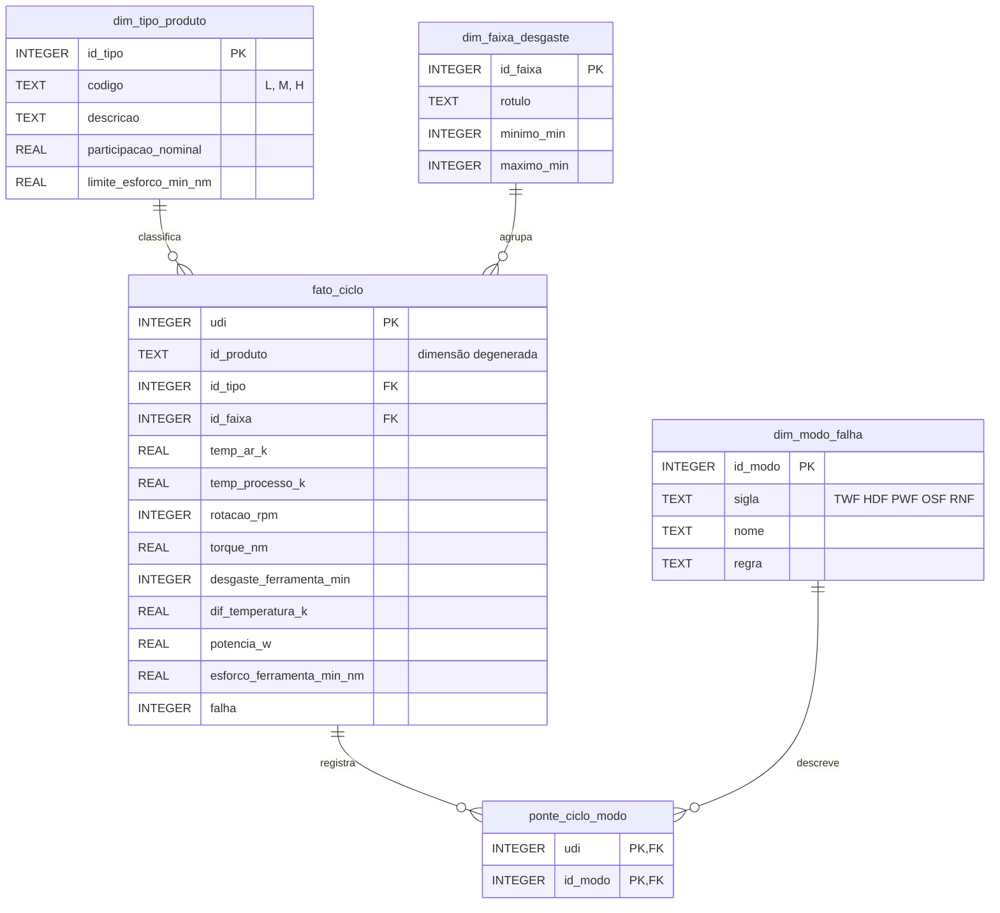

**Dicionário das tabelas.**

| Tabela | Coluna | Tipo | Descrição | Origem |
|---|---|---|---|---|
| `dim_tipo_produto` | `id_tipo` | INTEGER PK | chave substituta (1, 2, 3) | gerada |
| | `codigo` | TEXT | L, M ou H | coluna `tipo` |
| | `descricao` | TEXT | baixa, média ou alta qualidade | documentação da UCI |
| | `participacao_nominal` | REAL | 0,5 / 0,3 / 0,2 da produção | documentação da UCI |
| | `limite_esforco_min_nm` | REAL | limite de desgaste × torque do tipo (11/12/13 mil) | regra do OSF (UCI) |
| `dim_faixa_desgaste` | `id_faixa` | INTEGER PK | chave substituta (1 a 5) | gerada |
| | `rotulo`, `minimo_min`, `maximo_min` | TEXT, INTEGER | faixa de desgaste em min (`maximo_min` nulo = sem teto) | definida pelo grupo |
| `dim_modo_falha` | `id_modo` | INTEGER PK | chave substituta (1 a 5) | gerada |
| | `sigla`, `nome`, `regra` | TEXT | modo de falha e a regra que o gera | documentação da UCI |
| `fato_ciclo` | `udi` | INTEGER PK | identificador do ciclo | coluna `udi` |
| | `id_produto` | TEXT | dimensão degenerada | coluna `id_produto` |
| | `id_tipo`, `id_faixa` | INTEGER FK | ligação com as dimensões | derivadas na carga |
| | 5 sensores e 3 derivadas | REAL/INTEGER | medições do ciclo | DataFrame preparado (seção 2.2) |
| | `falha` | INTEGER | alvo binário | coluna `falha` |
| `ponte_ciclo_modo` | `udi`, `id_modo` | INTEGER PK/FK | um par por modo marcado no ciclo | colunas `falha_twf` … `falha_rnf` |

**Volume e integridade.** O banco tem 3 tipos, 5 faixas, 5 modos, 10.000 ciclos na fato e 373
linhas na ponte ([`02_volume_tabelas.csv`](reports/tables/02_volume_tabelas.csv)).
`verificar_integridade()` compara o banco com o DataFrame de origem, e as 6 verificações passam
([`02_integridade.csv`](reports/tables/02_integridade.csv)):

| Verificação | Esperado | Obtido |
|---|---:|---:|
| linhas na fato = linhas do DataFrame | 10.000 | 10.000 |
| falhas na fato = soma do alvo | 339 | 339 |
| linhas na ponte = soma dos 5 modos | 373 | 373 |
| violações de chave estrangeira | 0 | 0 |
| ciclos sem tipo | 0 | 0 |
| soma do torque confere | 399.869,1 | 399.869,1 |

As 7 verificações automatizadas de `tests/test_modelo_dados.py` repetem essas contagens e os
resultados das consultas a cada execução do CI.

#### 3.1.2 Modelos preditivos
<!-- RESPONSÁVEL: @rcolinneto · T4 -->
O código está em `src/manutencao/modelagem.py`, testado em `tests/test_modelagem.py` e executado
no [notebook 04](notebooks/04_modelagem_preditiva.ipynb).

| Função | O que faz |
|---|---|
| `validacao()` | `StratifiedKFold` de 5 dobras com `SEED`, usado em todas as etapas |
| `preprocessador()` | `ColumnTransformer`: `tipo` → ordinal L < M < H; numéricas padronizadas ou não |
| `modelos_candidatos()` | os 5 estimadores e se cada um precisa de padronização |
| `montar_pipeline()` | `Pipeline` pré-processamento + modelo |
| `avaliar_cv()` | validação cruzada com as 7 métricas; média e desvio de cada uma |
| `comparar_modelos()` | `avaliar_cv()` para cada modelo × conjunto de atributos, ordenado por PR-AUC |
| `ajustar_hiperparametros()` | `RandomizedSearchCV` (15 combinações, PR-AUC) e reajuste no treino todo |
| `probabilidades_oof()` | probabilidades *out-of-fold* no treino (`cross_val_predict`) |
| `metricas_teste()` | métricas de ranqueamento e de decisão para um limiar |
| `recall_por_modo()` | ciclos do teste e fração detectada em cada modo de falha |

**Modelo escolhido** ([`04_modelo_escolhido.csv`](reports/tables/04_modelo_escolhido.csv)):
HistGradientBoosting com os atributos de `engenharia`, taxa de aprendizado 0,03, 400 iterações,
até 63 folhas por árvore, mínimo de 10 ciclos por folha e regularização L2 = 1,0; PR-AUC média de
0,8949 na validação cruzada. As 10 melhores combinações da busca estão em
[`04_busca_hiperparametros.csv`](reports/tables/04_busca_hiperparametros.csv).

O modelo não é serializado: o notebook o retreina de forma determinística (`SEED = 42`), e o que
os passos seguintes consomem são as probabilidades, gravadas em
[`04_oof_treino.csv`](reports/tables/04_oof_treino.csv) (8.000 ciclos do treino) e
[`04_predicoes_teste.csv`](reports/tables/04_predicoes_teste.csv) (2.000 ciclos do teste).

### 3.2 Análise dos resultados
#### 3.2.1 O que a exploração mostrou
<!-- RESPONSÁVEL: @adrian-cesar · T3 -->
1. **O alvo é muito desbalanceado:** 339 falhas em 10.000 ciclos (3,39 %). Um modelo que sempre
   diz "sem falha" acerta 96,61 %, por isso a acurácia não serve e a métrica principal é a PR-AUC.

   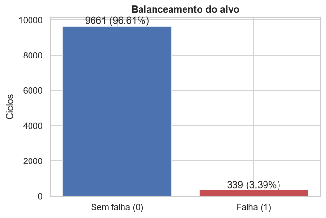

2. **Modos de falha:** HDF (115), OSF (98) e PWF (95) dominam; TWF (46) e RNF (19) são minoria.
   A soma dos modos (373) passa de 339 porque 24 falhas têm mais de um modo, e 9 falhas não têm
   modo ([`03_modos_falha.csv`](reports/tables/03_modos_falha.csv)).
3. **Todas as 8 variáveis diferem entre as classes** após Bonferroni (maior p ajustado
   5,2 × 10⁻⁴). Os maiores efeitos são do **torque** (r = +0,54; mediana 53,7 Nm nas falhas ×
   39,9 Nm sem falha), da **rotação** (r = −0,53; 1365 × 1507 rpm) e da **potência** (r = +0,49).
   A temperatura do processo tem o menor efeito (r = +0,13)
   ([`03_mann_whitney.csv`](reports/tables/03_mann_whitney.csv)).

   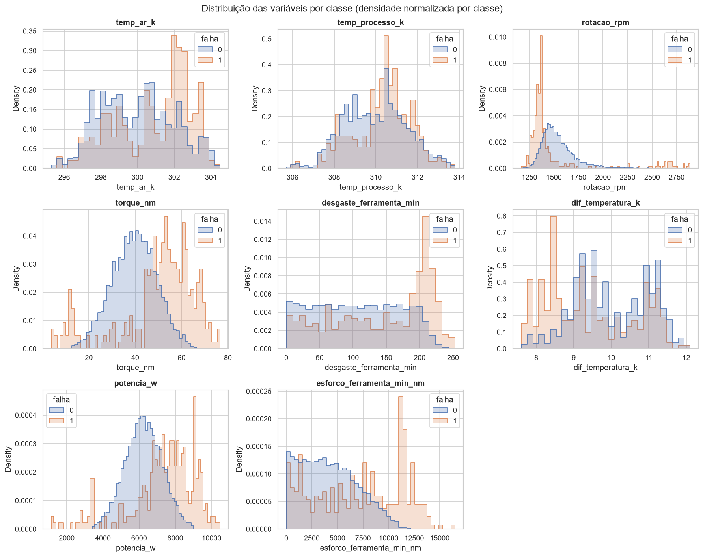

4. **Tipo de produto:** a taxa de falha cai de L (3,92 %) para M (2,77 %) e H (2,09 %). A
   associação é significativa (χ² = 13,75; 2 g.l.; p = 0,001), mas fraca: **V de Cramér = 0,037**
   ([`03_taxa_falha_por_tipo.csv`](reports/tables/03_taxa_falha_por_tipo.csv),
   [`03_qui_quadrado_tipo.csv`](reports/tables/03_qui_quadrado_tipo.csv)). O tipo pesa
   sobretudo porque define o limite de sobrecarga do OSF.
5. **Correlações por construção** (Spearman): potência × torque ρ = 0,98, esforço × desgaste
   ρ = 0,92, torque × rotação ρ = −0,92, temperatura do processo × do ar ρ = 0,86. Isso gera
   multicolinearidade para a regressão logística, sem efeito para árvores. Nenhuma variável
   isolada passa de |ρ| = 0,17 com a falha: ela depende de combinações de variáveis.
6. **As regras físicas aparecem nos dados:** as falhas HDF ficam todas no canto de diferença de
   temperatura < 8,6 K e rotação < 1380 rpm; as PWF, fora da faixa de 3500–9000 W; as OSF, acima
   do limite de esforço do tipo. Isso justifica os atributos `dif_temperatura_k`, `potencia_w` e
   `esforco_ferramenta_min_nm` na modelagem. TWF e RNF não têm região própria em um único ciclo,
   o que limita o recall possível (seção 3.3.1).

   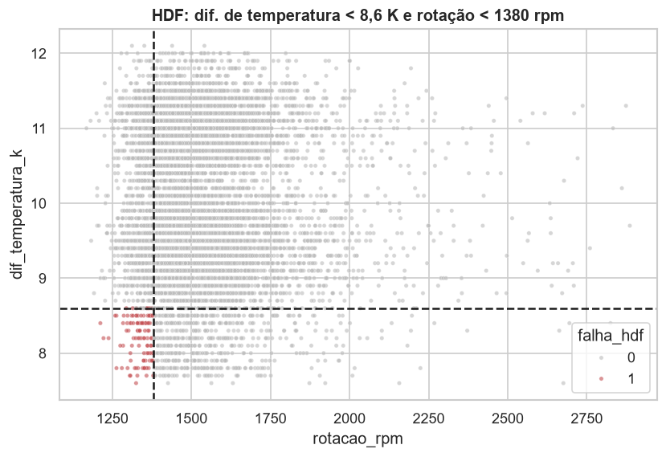
   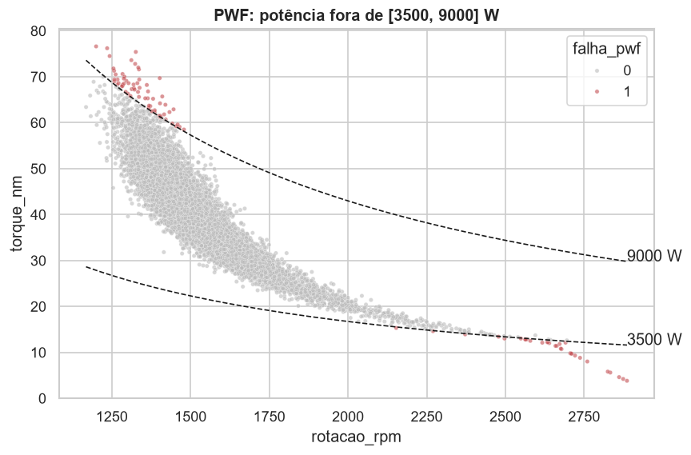
   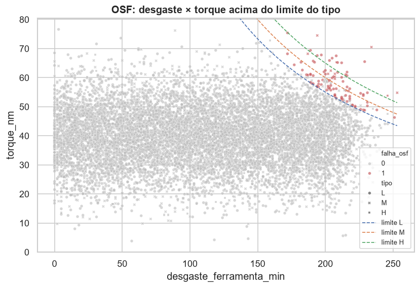

#### 3.2.2 Consultas analíticas no modelo dimensional
<!-- RESPONSÁVEL: @igorSeberino · T2 -->
`CONSULTAS` reúne 8 consultas SQL; cada resultado é gravado em `reports/tables/02_<nome>.csv`.

| Consulta | Pergunta de negócio |
|---|---|
| `taxa_falha_por_tipo` | A qualidade do produto muda a chance de falha? |
| `falhas_por_modo` | Quais modos de falha mais ocorrem? |
| `coocorrencia_modos` | Quais modos aparecem juntos no mesmo ciclo? |
| `taxa_falha_por_faixa_desgaste` | A partir de quanto desgaste a ferramenta passa a falhar mais? |
| `taxa_falha_por_tipo_e_faixa` | O efeito do desgaste é igual para todos os tipos? |
| `perfil_sensores_por_modo` | O que os sensores mostram de diferente em cada modo? |
| `esforco_acima_do_limite` | O limite de esforço do tipo explica a sobrecarga (OSF)? |
| `inconsistencias_rotulo` | O banco preserva as inconsistências de rótulo da seção 2.2? |

**Achados.**

1. **O desgaste age como um degrau, não como uma rampa.** Até 199 min a taxa de falha fica entre
   2,21 % e 2,66 %; na faixa 200+ min salta para **15,36 %** (123 falhas em 801 ciclos)
   ([`02_taxa_falha_por_faixa_desgaste.csv`](reports/tables/02_taxa_falha_por_faixa_desgaste.csv)).
   No tipo L essa faixa chega a **18,29 %**; em M e H fica em 10,31 % e 10,67 %
   ([`02_taxa_falha_por_tipo_e_faixa.csv`](reports/tables/02_taxa_falha_por_tipo_e_faixa.csv)).
2. **A qualidade do produto reduz a falha:** L 3,92 %, M 2,77 % e H 2,09 %
   ([`02_taxa_falha_por_tipo.csv`](reports/tables/02_taxa_falha_por_tipo.csv)).
3. **Dissipação de calor (HDF) é o modo mais frequente**, com 115 ocorrências (33,92 % das
   falhas), seguido de sobrecarga (98), potência (95), desgaste (46) e aleatória (19)
   ([`02_falhas_por_modo.csv`](reports/tables/02_falhas_por_modo.csv)). As porcentagens somam
   mais de 100 % porque **24 ciclos** têm mais de um modo; o par mais comum é PWF + OSF, com 12
   ciclos ([`02_coocorrencia_modos.csv`](reports/tables/02_coocorrencia_modos.csv)).
4. **O limite de esforço da dimensão de tipo explica 100 % da sobrecarga:** os 98 ciclos acima do
   limite do seu tipo (87 L, 9 M, 2 H) são exatamente os 98 com OSF
   ([`02_esforco_acima_do_limite.csv`](reports/tables/02_esforco_acima_do_limite.csv)).
5. **Cada modo tem uma assinatura de sensores.** TWF e OSF ocorrem com desgaste médio de 216 e
   208 min, contra 107 min nos ciclos sem falha; HDF ocorre com diferença de temperatura média de
   8,23 K e rotação de 1.337 rpm, contra 10,02 K e 1.540 rpm sem falha
   ([`02_perfil_sensores_por_modo.csv`](reports/tables/02_perfil_sensores_por_modo.csv)).
6. **O banco preserva os dados:** as mesmas 9 falhas sem modo e 18 modos sem falha da seção 2.2
   ([`02_inconsistencias_rotulo.csv`](reports/tables/02_inconsistencias_rotulo.csv)).

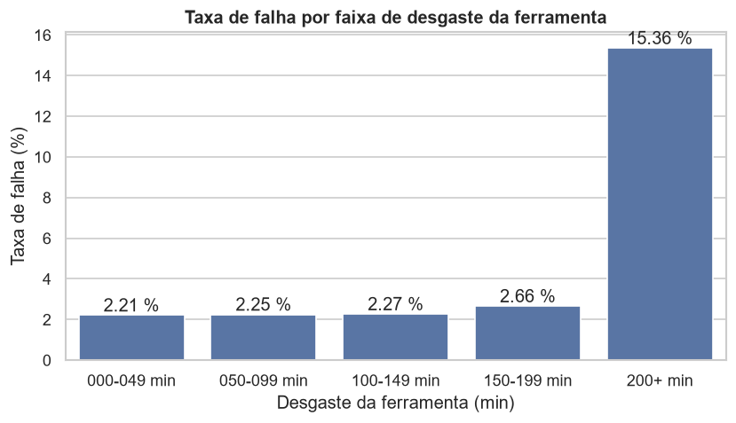

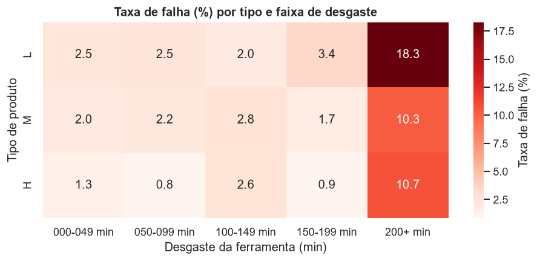

#### 3.2.3 Desempenho dos modelos
<!-- RESPONSÁVEL: @rcolinneto · T4 -->
**Comparação na validação cruzada** (treino, 5 dobras; recall, precisão e MCC no limiar 0,5;
[`04_comparacao_cv.csv`](reports/tables/04_comparacao_cv.csv)):

| Modelo | Atributos | PR-AUC (média ± dp) | ROC-AUC | Recall | Precisão | MCC |
|---|---|---:|---:|---:|---:|---:|
| HistGradientBoosting | `engenharia` | 0,890 ± 0,017 | 0,975 | 0,830 | 0,912 | 0,865 |
| Random Forest | `engenharia` | 0,889 ± 0,032 | 0,971 | 0,760 | 0,962 | 0,850 |
| HistGradientBoosting | `bruto` | 0,799 ± 0,033 | 0,972 | 0,782 | 0,699 | 0,729 |
| Árvore de Decisão | `engenharia` | 0,794 ± 0,053 | 0,917 | 0,886 | 0,403 | 0,578 |
| Random Forest | `bruto` | 0,766 ± 0,030 | 0,969 | 0,454 | 0,930 | 0,641 |
| Árvore de Decisão | `bruto` | 0,535 ± 0,060 | 0,843 | 0,793 | 0,317 | 0,476 |
| Regressão Logística | `engenharia` | 0,458 ± 0,041 | 0,923 | 0,845 | 0,162 | 0,328 |
| Regressão Logística | `bruto` | 0,443 ± 0,027 | 0,897 | 0,801 | 0,136 | 0,281 |
| Dummy | `bruto` | 0,034 ± 0,000 | 0,500 | 0,000 | 0,000 | 0,000 |
| Dummy | `engenharia` | 0,034 ± 0,000 | 0,500 | 0,000 | 0,000 | 0,000 |

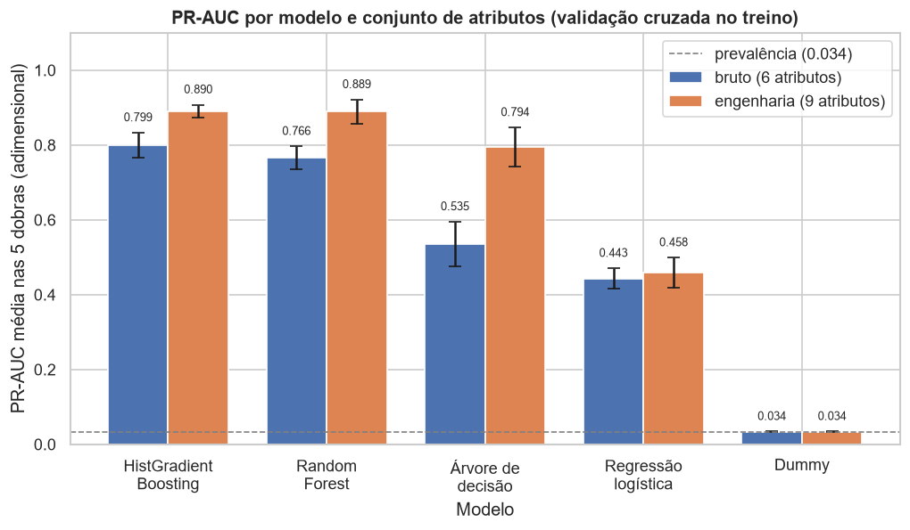

- Os atributos de `engenharia` melhoram todos os modelos; o ganho vai de 0,015 na regressão
  logística a 0,259 na árvore de decisão (0,535 → 0,794).
- A ROC-AUC esconde a diferença: o HistGradientBoosting tem ROC-AUC 0,972 com `bruto` e 0,975
  com `engenharia`, mas PR-AUC 0,799 e 0,890. A regressão logística com `engenharia` tem
  ROC-AUC 0,923 e precisão de só 0,162.
- HistGradientBoosting e Random Forest com `engenharia` empatam na prática (0,890 e 0,889, com
  desvios de 0,017 e 0,032). O HistGradientBoosting, de maior média, segue para o ajuste, que
  leva a PR-AUC a 0,8949, ganho menor que o desvio entre dobras.

**Avaliação final no teste** (2.000 ciclos, 68 falhas, limiar 0,5;
[`04_metricas_teste.csv`](reports/tables/04_metricas_teste.csv)):

| PR-AUC | ROC-AUC | Recall | Precisão | F1 | MCC | Acurácia balanceada |
|---:|---:|---:|---:|---:|---:|---:|
| 0,8976 | 0,9842 | 0,8382 | 0,9194 | 0,8769 | 0,8738 | 0,9178 |

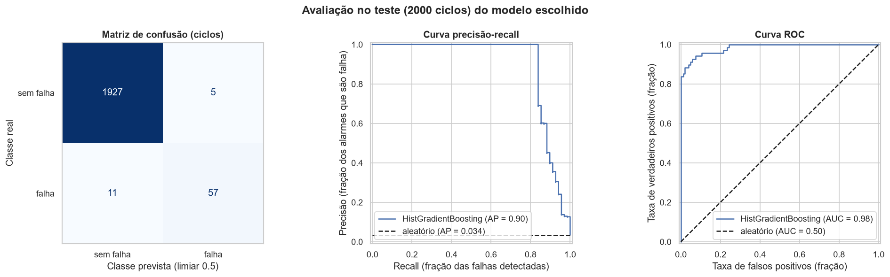

O modelo detecta 57 das 68 falhas e dá 5 alarmes falsos em 1.932 ciclos sem falha. A PR-AUC no
teste (0,8976) fica próxima da média da validação cruzada (0,8949).

**Recall por modo de falha** no teste ([`04_recall_por_modo.csv`](reports/tables/04_recall_por_modo.csv);
um ciclo pode ter mais de um modo):

| Modo | Ciclos no teste | Detectados | Recall |
|---|---:|---:|---:|
| TWF | 10 | 1 | 0,10 |
| HDF | 29 | 29 | 1,00 |
| PWF | 13 | 13 | 1,00 |
| OSF | 16 | 16 | 1,00 |
| RNF | 4 | 0 | 0,00 |
| SEM MODO | 2 | 0 | 0,00 |

As 11 falhas não detectadas são 9 de TWF sozinho e 2 sem modo. Os 4 ciclos com RNF no teste têm
todos `falha = 0` (inconsistências de rótulo da seção 2.2), então prever "sem falha" neles está
correto pelo alvo publicado.

**O que o modelo usa** ([`04_importancia_permutacao.csv`](reports/tables/04_importancia_permutacao.csv)):
a PR-AUC no teste cai 0,4888 ao embaralhar a rotação, 0,3842 com a diferença de temperatura,
0,1403 com o esforço da ferramenta e 0,1296 com a potência. As temperaturas do ar e do processo
ficam perto de zero (−0,0032 e −0,0054): a informação delas chega ao modelo pela diferença.

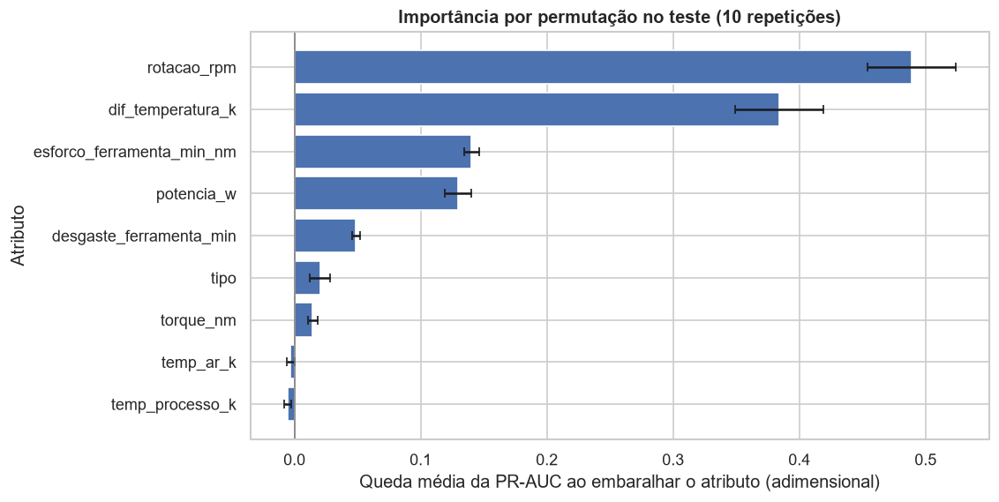

**Árvore rasa** (profundidade 3, treino;
[`04_regras_arvore_rasa.txt`](reports/tables/04_regras_arvore_rasa.txt),
[`04_folhas_arvore_rasa.csv`](reports/tables/04_folhas_arvore_rasa.csv)): sem receber nenhuma
regra, a árvore reencontra os limiares de geração documentados pela UCI (MATZKA, 2020) —
rotação ≤ 1386,50 rpm e ΔT ≤ 8,65 K para HDF (regra: < 1380 rpm e < 8,6 K), potência
≤ 3496,14 W para PWF (regra: < 3500 W) e esforço > 11013,60 e > 10972,10 min·N·m para OSF
(regra do tipo L: > 11.000). Para TWF, ela separa a zona de desgaste > 204,50 min, mas só 33
dos 368 ciclos do treino nessa zona falham (9,0 %).

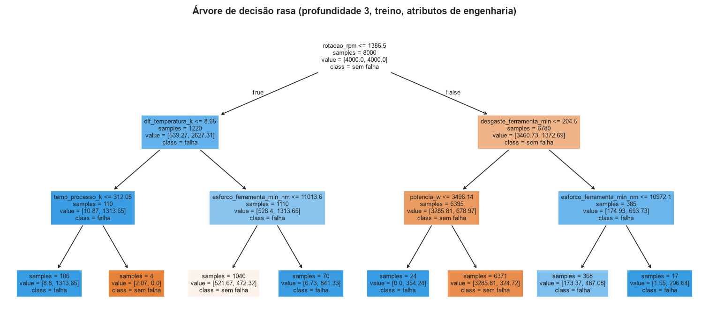

#### 3.2.4 Impacto financeiro
<!-- RESPONSÁVEL: @gabrielcarvallho · T6 -->
No teste (2.000 ciclos, 68 falhas), com intervenção de R$ 500 e falha de R$ 5.000 (hipóteses;
fonte: `reports/tables/05_estrategias_teste.csv`):

| Estratégia | Parâmetro (escolhido no treino) | Intervenções | Falhas evitadas | Falhas não evitadas | Custo por 1.000 ciclos (R$) | Economia vs. corretiva |
|---|---|---|---|---|---|---|
| Corretiva | - | 0 | 0 | 68 | 170.000 | - |
| Preventiva | desgaste ≥ 205 min | 125 | 18 | 50 | 156.250 | 8,1 % |
| Preditiva | proba ≥ 0,23 | 70 | 57 | 11 | 45.000 | 73,5 % |

A preditiva custa 71,2 % menos que a preventiva. O limiar 0,23 detecta as mesmas 57 falhas que o
0,5 do notebook 04, mas com 13 alarmes falsos em vez de 5: R$ 90.000 contra R$ 86.000 no teste.
Nesta amostra o limiar escolhido no treino ficou um pouco pior que 0,5; ele não foi
reajustado, porque isso seria escolher parâmetro olhando o teste.

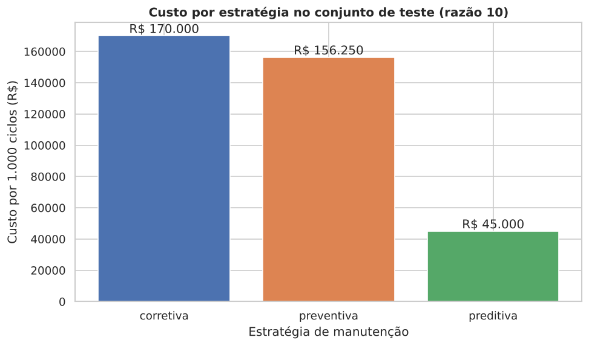

Na sensibilidade (`reports/tables/05_sensibilidade.csv`), a preditiva é a mais barata em todas
as razões: R$ 20.000 por 1.000 ciclos na razão 2 (contra R$ 34.000 das outras duas) e R$ 122.250
na razão 50 (contra R$ 500.000 da preventiva e R$ 850.000 da corretiva). O limiar escolhido cai
de 0,91 (razão 2) para 0,01 (razão 50): quanto mais cara a falha, mais vale aceitar alarmes
falsos.

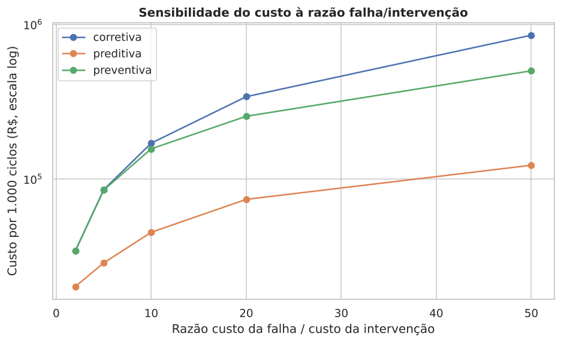

### 3.3 Discussão sobre a eficácia das soluções propostas
#### 3.3.1 Eficácia técnica e limitações do modelo
<!-- RESPONSÁVEL: @rcolinneto · T4 -->
**O modelo resolve o problema técnico.** No teste, nunca usado em nenhuma escolha, o
HistGradientBoosting tem PR-AUC 0,8976, contra 0,034 do piso, e detecta 57 das 68 falhas com 5
alarmes falsos no limiar 0,5. O resultado bate com a validação cruzada (0,8949) e com as
predições *out-of-fold* do treino: não há sinal de sobreajuste nem de vazamento, que
apareceriam como um teste muito acima da validação.

**O que mais pesa é o conhecimento do domínio.** Os três atributos físicos melhoram todos os
modelos, e dois deles estão entre os quatro mais importantes. O ajuste de hiperparâmetros
acrescentou menos que o desvio entre dobras. Para uma fábrica, a lição é que medir as grandezas
certas (potência, dissipação de calor, esforço da ferramenta) vale mais que trocar de algoritmo.

**O que escapa, e por que é esperado.** HDF, PWF e OSF são 100 % detectados porque são regras
determinísticas sobre as leituras do ciclo (seção 2.2; gráficos das regras na seção 3.2.1), e a
árvore rasa reencontra os limiares dessas regras. As falhas que escapam são de outra natureza:
TWF é a troca ou falha da ferramenta sorteada quando o desgaste está entre cerca de 200 e 240 min
(UCI MACHINE LEARNING REPOSITORY, 2020). A leitura do ciclo mostra que a ferramenta está na zona
de risco, mas não **qual** ciclo vai falhar, e só 9,0 % dos ciclos do treino nessa zona falham.
As falhas sem modo não seguem regra nenhuma. O teto de recall realista é dado por essa parcela,
não pelo algoritmo.

**Limitações.**

- **Dataset sintético.** Os dados foram gerados pelas regras documentadas (MATZKA, 2020). O
  desempenho perto do teto mede quanto o modelo reaprende essas regras, e **não se transfere
  automaticamente** para uma máquina real, onde as falhas não seguem limiares exatos, os sensores
  têm ruído e deriva, e os modos se misturam.
- **Sem série temporal.** Cada ciclo é tratado como independente: não há identificação da
  máquina nem da ferramenta ao longo do tempo. O modelo responde "este ciclo tende a falhar?",
  mas não estima a vida útil restante da ferramenta.
- **Ruído de rótulo.** 27 linhas têm rótulo inconsistente (9 falhas sem modo e 18 ciclos com RNF
  e sem falha;
  [`01_inconsistencias_rotulo.csv`](reports/tables/01_inconsistencias_rotulo.csv)); mantidas como
  publicadas (D5), elas limitam o que qualquer modelo pode acertar.
- **Limiar padrão.** As métricas de decisão usam 0,5, que não considera o custo de cada erro. O
  limiar por custo é escolhido no notebook 05 (seção 2.4.3).

**Com dados reais, faríamos diferente:** coletar a série de leituras por máquina e por
ferramenta, para modelar o desgaste ao longo do tempo e estimar a vida útil restante; validar
de forma temporal (treinar no passado e testar no futuro) em vez de uma divisão aleatória;
recalibrar o limiar com os custos reais da fábrica; e monitorar a deriva dos sensores depois da
implantação.

#### 3.3.2 Eficácia para o negócio
<!-- RESPONSÁVEL: @gabrielcarvallho · T6 -->
**A solução reduz o custo, e a vantagem não depende do valor exato adotado.** Na razão 10, a
preditiva custa R$ 45.000 por 1.000 ciclos contra R$ 170.000 da corretiva; e continua à frente
nas razões 2, 5, 20 e 50. Quanto maior a razão, maior a economia relativa. Em razão baixa
(2), a preventiva ótima converge para não intervir nunca e iguala a corretiva.

**A preventiva por desgaste pega pouco.** Com limite de 205 min, evita 18 das 68 falhas e faz
125 intervenções. HDF, PWF e OSF não dependem do desgaste da ferramenta; só o TWF depende, e
mesmo ele falha de forma estocástica na zona de desgaste alto. O modelo preditivo detecta
100 % de HDF, PWF e OSF no teste (`04_recall_por_modo.csv`) porque combina temperatura,
rotação, torque e esforço.

**Riscos e limites.** Os custos são hipotéticos; o dataset é sintético; a avaliação usa uma
única divisão treino/teste com 68 falhas, então diferenças pequenas entre limiares (como
0,23 e 0,5) estão dentro do ruído. Sobram 11 falhas não evitadas, ligadas a TWF e RNF (este
último é aleatório por construção) e a 2 falhas sem modo registrado.

**O que seria preciso para implantar.** Levantar os custos reais de intervenção e de parada;
recalibrar o limiar com eles; rodar um piloto em uma máquina antes de expandir; e monitorar a
deriva dos sensores e o custo realizado depois da implantação.

### 3.4 Implementação em Python
<!-- RESPONSÁVEL: @igorSeberino · T7 -->
_Em construção._

### 3.5 Considerações finais
<!-- RESPONSÁVEL: @igorSeberino · T7 -->
_Em construção._

## 4. Referências
<!-- RESPONSÁVEL: @adrian-cesar · T5 (demais integrantes acrescentam as que citarem) -->
BREIMAN, L. Random forests. **Machine Learning**, v. 45, n. 1, p. 5-32, 2001. DOI: https://doi.org/10.1023/A:1010933404324.

CARVALHO, T. P. *et al.* A systematic literature review of machine learning methods applied to predictive maintenance. **Computers & Industrial Engineering**, v. 137, 106024, 2019. DOI: https://doi.org/10.1016/j.cie.2019.106024.

CHICCO, D.; JURMAN, G. The advantages of the Matthews correlation coefficient (MCC) over F1 score and accuracy in binary classification evaluation. **BMC Genomics**, v. 21, n. 1, 6, 2020. DOI: https://doi.org/10.1186/s12864-019-6413-7.

CONFEDERAÇÃO NACIONAL DA INDÚSTRIA (CNI). **Desafios para indústria 4.0 no Brasil**. Brasília: CNI, 2016. Disponível em: https://www.portaldaindustria.com.br/publicacoes/2016/8/desafios-para-industria-40-no-brasil/. Acesso em: 23 out. 2026.

FRIEDMAN, J. H. Greedy function approximation: a gradient boosting machine. **The Annals of Statistics**, v. 29, n. 5, p. 1189-1232, 2001. DOI: https://doi.org/10.1214/aos/1013203451.

HARRIS, C. R. *et al.* Array programming with NumPy. **Nature**, v. 585, n. 7825, p. 357-362, 2020. DOI: https://doi.org/10.1038/s41586-020-2649-2.

HUNTER, J. D. Matplotlib: a 2D graphics environment. **Computing in Science & Engineering**, v. 9, n. 3, p. 90-95, 2007. DOI: https://doi.org/10.1109/MCSE.2007.55.

KAGERMANN, H.; WAHLSTER, W.; HELBIG, J. **Recommendations for implementing the strategic initiative INDUSTRIE 4.0**: final report of the Industrie 4.0 Working Group. Frankfurt am Main: acatech, 2013. Disponível em: https://www.acatech.de/wp-content/uploads/2018/03/Final_report__Industrie_4.0_accessible.pdf. Acesso em: 23 out. 2026.

KIMBALL, R.; ROSS, M. **The data warehouse toolkit**: the definitive guide to dimensional modeling. 3. ed. Indianapolis: Wiley, 2013.

LEE, J.; BAGHERI, B.; KAO, H.-A. A cyber-physical systems architecture for Industry 4.0-based manufacturing systems. **Manufacturing Letters**, v. 3, p. 18-23, 2015. DOI: https://doi.org/10.1016/j.mfglet.2014.12.001.

MANN, H. B.; WHITNEY, D. R. On a test of whether one of two random variables is stochastically larger than the other. **The Annals of Mathematical Statistics**, v. 18, n. 1, p. 50-60, 1947. DOI: https://doi.org/10.1214/aoms/1177730491.

MATZKA, S. Explainable artificial intelligence for predictive maintenance applications. *In*: INTERNATIONAL CONFERENCE ON ARTIFICIAL INTELLIGENCE FOR INDUSTRIES (AI4I), 3., 2020, Irvine. **Proceedings** [...]. IEEE, 2020. p. 69-74. DOI: https://doi.org/10.1109/AI4I49448.2020.00023.

McKINNEY, W. Data structures for statistical computing in Python. *In*: PYTHON IN SCIENCE CONFERENCE, 9., 2010, Austin. **Proceedings** [...]. 2010. p. 56-61. DOI: https://doi.org/10.25080/Majora-92bf1922-00a.

MOBLEY, R. K. **An introduction to predictive maintenance**. 2. ed. Amsterdam: Butterworth-Heinemann, 2002.

PEDREGOSA, F. *et al.* Scikit-learn: machine learning in Python. **Journal of Machine Learning Research**, v. 12, p. 2825-2830, 2011. Disponível em: https://www.jmlr.org/papers/v12/pedregosa11a.html. Acesso em: 23 out. 2026.

SAITO, T.; REHMSMEIER, M. The precision-recall plot is more informative than the ROC plot when evaluating binary classifiers on imbalanced datasets. **PLOS ONE**, v. 10, n. 3, e0118432, 2015. DOI: https://doi.org/10.1371/journal.pone.0118432.

SHEARER, C. The CRISP-DM model: the new blueprint for data mining. **Journal of Data Warehousing**, v. 5, n. 4, p. 13-22, 2000.

UCI MACHINE LEARNING REPOSITORY. **AI4I 2020 predictive maintenance dataset**. 2020. DOI: https://doi.org/10.24432/C5HS5C. Acesso em: 23 out. 2026.

VIRTANEN, P. *et al.* SciPy 1.0: fundamental algorithms for scientific computing in Python. **Nature Methods**, v. 17, n. 3, p. 261-272, 2020. DOI: https://doi.org/10.1038/s41592-019-0686-2.

WASKOM, M. L. seaborn: statistical data visualization. **Journal of Open Source Software**, v. 6, n. 60, 3021, 2021. DOI: https://doi.org/10.21105/joss.03021.

ZONTA, T. *et al.* Predictive maintenance in the Industry 4.0: a systematic literature review. **Computers & Industrial Engineering**, v. 150, 106889, 2020. DOI: https://doi.org/10.1016/j.cie.2020.106889.

## Contribuindo

Fluxo Trunk-Based com o time de agentes do Claude Code em [`.claude/`](.claude/README.md):
`/setup` → `/tbd-start <issue>` → implementação → `/tbd-commit` → `/tbd-pr`. Regras do projeto
em [`CLAUDE.md`](CLAUDE.md); cada PR precisa de CI verde e aprovação de outro integrante.

## Dados
Dados: *AI4I 2020 Predictive Maintenance Dataset*, UCI Machine Learning Repository,
https://doi.org/10.24432/C5HS5C, licença CC BY 4.0 (cópia em `data/raw/ai4i2020.csv`).
